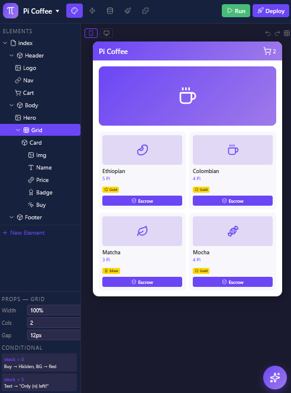

# Pi Visual Builder

> ### ⚠️ Status: design specification + static mockups — **no implementation yet**
>
> This repository contains **documentation and static HTML pages that illustrate the intended user interface**.
> There is no runnable application here.
>
> | | |
> |---|---|
> | **Exists today** | 6 specification documents and 4 static HTML mockups (no build step, no backend). |
> | **Does not exist yet** | Any application: no `package.json`, no source directory, no build, no tests, no runtime. The "mockups" are static pages — not a working product. |
> | **Roadmap status** | Every phase below is marked `Proposed`. None has started. |
> | **Proposal status** | Submitted to the community PiRC repository as [Issue #381](https://github.com/PiNetwork/PiRC/issues/381) and [PR #382](https://github.com/PiNetwork/PiRC/pull/382). Both are **open**. |
> | **About the "PiRC4" name** | The official [`PiNetwork/PiRC`](https://github.com/PiNetwork/PiRC) repository currently contains only `PiRC1` and `PiRC2`. **"PiRC4" is not an assigned number** — it is a placeholder used in this proposal. Numbers are assigned by the Pi Core Team, and the proposals above have not been merged or assigned. |



**Interactive mockups** (static HTML — open directly in a browser; no server, no build step):

| Mockup | Illustrates |
|---|---|
| [🎨 Design Tab](mockups/1-design-tab.html) | Visual canvas with elements tree, property editor, AI assistant |
| [⚡ Workflow Tab](mockups/2-workflow-tab.html) | Step-by-step logic chains with Pi payment & escrow actions |
| [🗄️ Data Tab](mockups/3-data-tab.html) | Relational database with PiDCTP-linked fields and privacy rules |
| [🎭 Styles Tab](mockups/4-styles-tab.html) | Color/font variables, element styles, live preview |

A static overview page is published with GitHub Pages: <https://aybvip.github.io/Pi-Visual-Builder/> — it is an **overview of the mockups**, not a demonstration of a working product.

## What this is

- A **design specification** for a visual, no-code app builder aimed at Pi App Studio and Pi Browser.
- **Static mockups** showing the intended editor layout and interaction model.
- A **voluntary, unaffiliated proposal** submitted to the community PiRC repository for consideration.

## What this is not

- **Not** a released or runnable product.
- **Not** affiliated with, endorsed by, or audited by Pi Network.
- **Not** an implementation of any on-chain component. The `pi.escrow.*` and `pi.reputation.*` names below are **proposed API shapes**, not deployed code.

## 📚 Specification documents

| # | Document | Covers |
|---|---|---|
| 1 | [Component Specification](docs/1-components.md) | 20+ proposed visual components (Layout, Display, Input, Navigation, Pi-Native) |
| 2 | [Logic Blocks](docs/2-logic-blocks.md) | Event, logic, data and Pi SDK blocks (proposed) |
| 3 | [Code Generation](docs/3-code-generation.md) | Proposed React/TS + HTML/CSS output and build pipeline |
| 4 | [Component Marketplace](docs/4-marketplace.md) | Proposed publishing, monetization, verification, discovery |
| 5 | [Example Apps](docs/5-examples.md) | 5 example app **concepts** (e-commerce, services, community, loyalty, HTML) with illustrative pseudo-code |
| 6 | [Editor UI Layout](docs/6-editor-ui-layout.md) | Proposed editor: canvas, property editor, AI assistant panel, workflow canvas, data tab, styles tab |

## Proposed workspace

> Everything in this section is **proposed design**. Nothing listed is implemented.

### The Pi AI Agent (Orchestrator)

The intended design is for an agent that is not merely a chatbot but an **active orchestrator** acting across the environment:

1. **Instant UI implementation** — "Build a form so users can apply to jobs" → create popup, add input fields, style them to match the theme.
2. **Logic & workflow generation** — "When the user clicks apply, save the data and send a confirmation" → a 3-step visual workflow: `Show Popup` → `Display Data` → `Send Confirmation`.
3. **Real-time design reworking** — "Rework the design to be more professional" → adjust padding, typography and colour schemes across the active screen.
4. **Database auto-schema** — suggest and create data types (e.g. `Job Application`) based on the form fields just built.

### Six proposed tabs

| Tab | Proposed behaviour |
|---|---|
| **1. Design** | Pixel-perfect drag-and-drop canvas, elements tree, responsive engine (mobile / tablet / desktop), property editor |
| **2. Workflow** | Vertical logic chains with event triggers (`Button is clicked`, `Page is loaded`, `Payment is confirmed`) and action steps |
| **3. Data** | Relational manager for objects such as `Merchant`, `EscrowTransaction`, `Job`, with field mapping and privacy rules |
| **4. API Connector** | Visual REST connector and visual blocks for Pi SDK functions |
| **5. Plugins & Marketplace** | Community plugins, author monetisation, discovery |
| **6. Styles** | Style variables, reusable presets, a Pi design-system token set |

## Proposed architecture

```
┌─────────────────────────────────────────────────────────────┐
│                   PI VISUAL BUILDER (VB)                    │
│                  (proposed — not built)                     │
├─────────────────────────────────────────────────────────────┤
│ 🤖 PI AI AGENT (Orchestrator: Generates UI, Logic, Data)    │
├──────────┬───────────┬───────────┬───────────┬──────────────┤
│  DESIGN  │ WORKFLOW  │   DATA    │    API    │   PLUGINS    │
│  CANVAS  │  ENGINE   │  MANAGER  │ CONNECTOR │  MARKETPLACE │
└──────────┴─────┬─────┴─────┬─────┴─────┬─────┴──────┬───────┘
                 │           │           │            │
      ┌──────────▼───────────▼───────────▼────────────▼───┐
      │               PI SDK & PiDCTP LAYER               │
      │   (On-Chain Auth, Payments, Escrow, Reputation)   │
      └──────────────────────────┬────────────────────────┘
                                 │
                 ┌───────────────▼───────────────┐
                 │       PI BROWSER RUNTIME      │
                 │   (React/TS Dynamic Web App)  │
                 └───────────────────────────────┘
```

## Relationship to PiDCTP

The intended design turns smart-contract calls into visual steps:

| Visual workflow step | Proposed backend action |
| :--- | :--- |
| `Verify Seller` | `pi.reputation.getEffectiveScore()` |
| `Create Milestone` | `pi.escrow.createMilestoneEscrow()` |
| `Release Payment` | `pi.escrow.confirmReceipt()` |
| `Lodge Complaint` | `pi.dispute.open()` |
| `Award Verified Badge` | `pi.reputation.awardBadge()` |

These function names are **shapes proposed here**, not APIs that exist on the Pi Mainnet today.

PiDCTP itself is a separate, also-unmerged proposal by the same author: [PR #378](https://github.com/PiNetwork/PiRC/pull/378) — **open, unassigned, no merged status**. Treat the table above as design intent, not as an integration guide.

## 📅 Roadmap

All four phases are `Proposed`. None has started.

| Phase | Feature | Status |
|-------|---------|--------|
| **Phase 1** | Visual foundation (UI canvas + basic workflows) | Proposed |
| **Phase 2** | Data intelligence (relational database + privacy rules) | Proposed |
| **Phase 3** | AI integration (agent for natural-language app building) | Proposed |
| **Phase 4** | Global ecosystem (plugin marketplace + Pi App Studio sync) | Proposed |

## Related proposals (honest status)

| Reference | What it is | Current status |
|---|---|---|
| [Issue #381](https://github.com/PiNetwork/PiRC/issues/381) | This proposal (Pi Visual Builder) | Open |
| [PR #382](https://github.com/PiNetwork/PiRC/pull/382) | This proposal, submitted as a pull request | Open |
| [PR #378](https://github.com/PiNetwork/PiRC/pull/378) | PiDCTP, a related on-chain proposal | Open |

None of the above has been merged, approved, or assigned an official PiRC number by the Pi Core Team.

## Contributing

See [CONTRIBUTING.md](CONTRIBUTING.md). Because this repository uses a source-available license that restricts forking and derivative works, changes are proposed **by opening an Issue** and applied by the maintainer.

## License

See [LICENSE](LICENSE). This repository uses a **source-available, idea-protection license — not an open-source license**: implementation rights are granted exclusively to Pi Network, and copying, forking, modification and implementation by anyone else are restricted. It is not an OSI-approved license.

---

### Links

- **Repository:** <https://github.com/aybvip/Pi-Visual-Builder>
- **Static overview page:** <https://aybvip.github.io/Pi-Visual-Builder/>
- **Proposals:** [Issue #381](https://github.com/PiNetwork/PiRC/issues/381) · [PR #382](https://github.com/PiNetwork/PiRC/pull/382) · [PR #378](https://github.com/PiNetwork/PiRC/pull/378) (PiDCTP)

### Author

Original concept by **Ayoub Boukadida** ([@aybvip](https://github.com/aybvip) / `@viperco`). Unofficial and unaffiliated with Pi Network.
